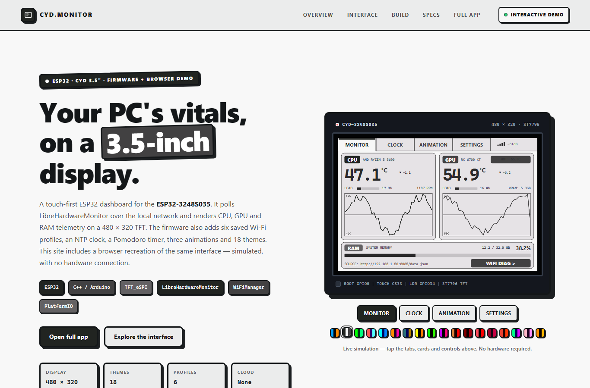
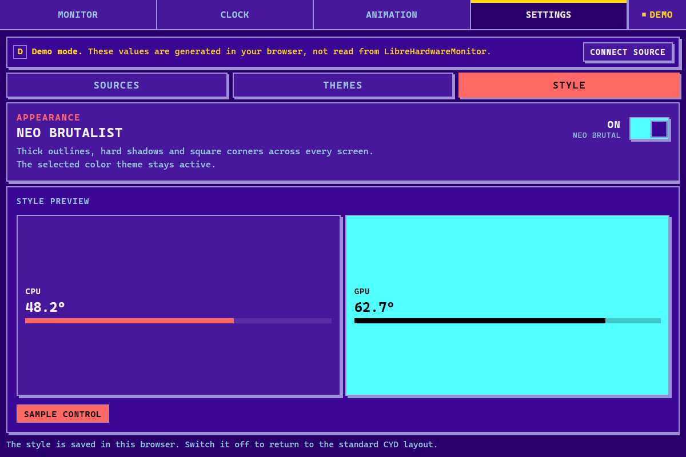

# CYMonitor

[](https://github.com/fidopecado/CYMonitor/actions/workflows/firmware.yml)
[](https://fidopecado.github.io/CYMonitor/)
[](LICENSE)

A touch-first ESP32 desk display for live PC telemetry, built around the **ESP32-3248S035 “CYD” 3.5″ board** and **LibreHardwareMonitor**. Fully local: no cloud, no account, no telemetry leaving the house.

The firmware polls a LibreHardwareMonitor JSON endpoint over Wi-Fi, scans the hardware tree for CPU, GPU and RAM sensors, and renders them on a 480 × 320 TFT with TFT_eSPI. The repository also ships a dependency-free browser recreation of the same screens — with 18 shared themes, a Neo Brutalist style switch and an optional live connection to the same endpoint — plus a Docker image that serves it.



*Browser recreation of the CYD interface. The landing-page simulator uses generated telemetry; the standalone app can read real sensors from LibreHardwareMonitor.*

**Try it:** [live demo](https://fidopecado.github.io/CYMonitor/) · [standalone app](https://fidopecado.github.io/CYMonitor/app.html) · [run it locally](#quick-start)

> The landing-page simulator is generated. The standalone web app at [`web/app.html`](web/app.html) can fetch a LibreHardwareMonitor `data.json` endpoint directly; it never controls the ESP32.

## Contents

- [What it does](#what-it-does)
- [Quick start](#quick-start)
- [Screens](#screens)
- [Architecture](#architecture)
- [Engineering notes](#engineering-notes)
- [Hardware](#hardware)
- [Web app](#web-app)
- [Repository layout](#repository-layout)
- [Getting started](#getting-started)
- [Docker](#docker)
- [Configuration](#configuration)
- [Limitations](#limitations)
- [Acknowledgements](#acknowledgements)

## What it does

- **Monitor** — reads LibreHardwareMonitor’s JSON tree and scores CPU/GPU/RAM sensor candidates by hardware type, sensor type and label. Displays temperature, load, package power or fan RPM when available, GPU hotspot and VRAM, RAM usage, trend badges, 40-sample sparklines and a stale-data state.
- **Wi-Fi diagnostics** — signal percentage, RSSI, channel, SSID, local IP, gateway, subnet, MAC and DNS, plus TCP latency probes to the gateway and one of three targets: Google, Cloudflare or Telkom.
- **Standby clock** — NTP time from `pool.ntp.org` at GMT+7, with a date line and seconds meter. There is no RTC; the clock depends on Wi-Fi and NTP.
- **Pomodoro** — 10, 15, 25 and 45-minute presets, 1–60 minute manual adjustment, start/pause/resume/reset, a 24-block progress wave, a five-dot session display and an eight-second PWM backlight alarm.
- **Animations** — 24-column Matrix rain with 80–160 px/s fall speeds, a 50-star 3D starfield, a bouncing DVD sprite and an on-screen measured-FPS HUD.
- **Settings** — six saved Wi-Fi profiles, each with its own password and JSON endpoint, plus 18 RGB565 themes. The firmware pages the gallery six at a time and stores profiles, endpoints and the selected theme in NVS. The web app adds adaptive pagination and a persistent **Neo Brutalist** style switch.
- **Touch UI** — header tabs, tappable cards, long-press to forget a network, swipe paging in the theme gallery and a physical BOOT-button page shortcut.

## Quick start

| Goal | Command |
| --- | --- |
| Flash the CYD | `pio run --target upload` |
| Serve the complete web experience | `docker compose up --build` → <http://localhost:8080> |
| Preview the static app | `cd web && python -m http.server 8099` → <http://127.0.0.1:8099> |
| Connect live telemetry | LibreHardwareMonitor → **Options → Remote Web Server → Run** |

The firmware and web app are independent: the CYD can read LibreHardwareMonitor directly over Wi-Fi, while the browser app connects to the same `data.json` endpoint. See [Getting started](#getting-started) for first-boot Wi-Fi setup and live-data details.

## Screens

| Screen | Purpose |
| --- | --- |
| **Monitor** | CPU/GPU cards, RAM card, 40-sample sparklines and a Wi-Fi diagnostics sub-page. |
| **Clock** | NTP standby clock and the Pomodoro timer. |
| **Animation** | Matrix rain, 3D starfield and bouncing DVD modes. |
| **Settings** | Saved networks and themes on the CYD; Sources, Themes and Style (including Neo Brutalist) in the web app. |

The web version contains all four screens. [web/index.html](web/index.html) is the project landing page with an embedded simulator; [web/app.html](web/app.html) opens the CYD interface alone, without site chrome, and can connect to a live LibreHardwareMonitor source.

## Architecture

```text
LibreHardwareMonitor on a Windows PC
  └─ Options → Remote Web Server → Run
       └─ http://<pc-ip>:8085/data.json
              │
              │  Wi-Fi / HTTP
              ▼
ESP32-3248S035
  ├─ httpFetchTask (core 0, priority 1, 12 KB stack)
  │    └─ JSON filter → sensor scan → LiveData snapshot
  ├─ NVS (Preferences)
  │    └─ theme, six Wi-Fi profiles, per-profile endpoint
  └─ TFT_eSPI 480 × 320
       ├─ Monitor
       ├─ Clock / Pomodoro
       ├─ Animation
       └─ Settings
```

The firmware is a single translation unit in [`src/main.cpp`](src/main.cpp). The fetch task runs only while the Monitor page is on its hardware sub-page; it applies a JSON filter and a nesting limit before scanning, then commits the snapshot to the UI.

## Engineering notes

The interesting part of this project is not the drawing code — it is the budget.

| Constraint | Value | Why it matters |
| --- | --- | --- |
| LibreHardwareMonitor tree | ~120 KB JSON | Far larger than the usable ESP32 heap, so it cannot be buffered and parsed whole. |
| JSON nesting limit | 12 levels | Bounds ArduinoJson’s document depth before any allocation happens. |
| JSON filter | compiled filter, applied pre-parse | Drops unused fields so only sensor names, types and values are materialized. |
| Fetch task | core 0, priority 1, 12 KB stack | Keeps the network task off the render loop and out of the UI’s stack budget. |
| HTTP timeouts | 4 s connect, 10 s response | A dropped Wi-Fi link degrades to the stale state instead of blocking rendering. |
| Polling | 400 ms delay after each request | Caps request rate while the Monitor hardware view is active. |
| History | ~1 sample/s, 40 per series | Sparklines cost a fixed 40-entry ring buffer, not a growing array. |
| Firmware binary | ~1.1 MB | Ships inside the `huge_app.csv` partition with room for the theme and profile tables. |

Two product decisions follow from that: the UI shows an explicit stale/offline state rather than fake values, and every panel degrades to `--` when a sensor is missing instead of shifting layout.

Other firmware notes:

- **Stack:** Arduino framework with TFT_eSPI `^2.5.43`, ArduinoJson `^7.0.0` and WiFiManager.
- **Board target:** `esp32dev` with the `huge_app.csv` partition.
- **Themes:** 18 palettes in RGB565. The firmware shows six at a time in a two-column, three-row gallery and writes the selection to NVS. The web gallery fits 6, 9 or 18 cards per page and defaults to E-INK. Both restore the last saved palette.
- **Brightness:** the LDR is smoothed and mapped to a PWM duty range of 15–255. During a Pomodoro alarm, the backlight blinks for eight seconds.
- **Time:** `configTime()` with `pool.ntp.org`, GMT+7 and no daylight-saving offset.
- **Networking:** six saved profiles are tried automatically. If no profile connects, the board starts the `CYMonitor-AP` captive portal and restarts after the 240-second portal timeout.

## Hardware

| Item | Detail |
| --- | --- |
| Board | ESP32-3248S035 (CYD 3.5″) |
| MCU | ESP32, dual-core 240 MHz |
| Display | ST7796, 480 × 320, landscape |
| Display SPI | 65 MHz |
| Touch | TFT_eSPI touch controller, CS 33, 2.5 MHz |
| Backlight | GPIO 27, PWM |
| Light sensor | LDR on GPIO 34 |
| Page shortcut | BOOT button on GPIO 0 |
| TFT pins | MOSI 13, MISO 12, SCLK 14, CS 15, DC 2 |
| Storage | ESP32 Preferences (NVS) |

The pin map, display driver, SPI speeds and partition table are defined in [`platformio.ini`](platformio.ini).

## Web app

The web folder is a dependency-free static site with two entry points:

- [web/index.html](web/index.html) — project landing page with an embedded, generated-telemetry simulator.
- [web/app.html](web/app.html) — the CYD screens alone: Monitor, Clock/Pomodoro, Animation and Settings (Sources, Themes and Style).
- [web/app.css](web/app.css) — fluid full-screen layout and the Neo Brutalist skin.
- [web/app-live.js](web/app-live.js) — live LibreHardwareMonitor scanner, browser clock, Pomodoro, animations, settings, source handling and persistent UI style.
- [web/app.js](web/app.js) — theme engine and generated telemetry for the landing-page simulator.
- [web/theme-data.js](web/theme-data.js) — the shared 18 RGB565 palettes.
- [web/styles.css](web/styles.css) — landing-page and simulated-device styling.

The standalone app is designed as a web representation of the CYD screens, not a separate dashboard. It fills the available browser or phone viewport, uses the same palette set as the firmware, and keeps the CYD tab structure and screen hierarchy. Clock mode uses the browser's local time and shows the computed GMT offset; there is no NTP requirement on the web.

There is no build step: the pages are served as-is. [`.github/workflows/pages.yml`](.github/workflows/pages.yml) publishes `web/` to GitHub Pages on every push to `main`.

### Style and themes

Settings has three tabs. The theme gallery measures the available grid and shows 6, 9 or 18 title-and-palette cards per page, so selection stays usable on phones and desktop. The **Style** tab adds a Neo Brutalist switch that changes geometry — square corners, thick outlines, hard offset shadows and chunky controls — while keeping the selected color palette. The choice is stored in browser local storage and applied before CSS loads to avoid a flash of the standard layout.



*Neo Brutalist layout with the DRACULA palette. The selected palette and the UI style are independent.*

### Live LibreHardwareMonitor data

1. Start LibreHardwareMonitor on the Windows PC that owns the sensors.
2. Open **Options → Remote Web Server → Run**.
3. Confirm `http://<pc-ip>:8085/data.json` opens in a browser on the same network.
4. Serve this folder over HTTP (for example `python -m http.server 8099` from `web/`) and open `http://127.0.0.1:8099/app.html`.
5. Enter the `data.json` URL in the setup screen.

LibreHardwareMonitor sends `Access-Control-Allow-Origin: *` by default, so the app can fetch it directly. Use the plain `/data.json` URL: LHM's built-in server returns 404 for URLs with query strings such as `/data.json?x=1`. The page must be served over HTTP or localhost: an HTTPS page cannot fetch an HTTP endpoint because browsers block mixed content. The app does not request Wi-Fi credentials. The endpoint URL is stored only in browser local storage.

If the source cannot be reached, the app shows a clearly labeled **DEMO** mode or a **STALE/OFFLINE** state; live values are never silently replaced by generated ones. The landing-page simulator remains generated and is labeled as such.

**Why the public demo is not live:** GitHub Pages is served over HTTPS, and LibreHardwareMonitor is HTTP-only, so a browser blocks the request as mixed content. The hosted demo therefore runs generated telemetry. For a live view, use the Docker image below, which can proxy the sensor endpoint on the same origin.

## Repository layout

```text
.
├── src/
│   └── main.cpp              # ESP32 firmware
├── platformio.ini            # board, libraries, display and touch configuration
├── web/
│   ├── index.html            # landing page + embedded simulator
│   ├── app.html              # standalone CYD screens
│   ├── app.css               # full-screen CYD layout
│   ├── app-live.js           # live LibreHardwareMonitor runtime
│   ├── app.js                # landing simulator
│   ├── theme-data.js         # shared 18 RGB565 palettes
│   └── styles.css            # landing page + simulated-device styles
├── docs/
│   ├── preview.png           # landing-page screenshot
│   └── neo-brutalist.png     # web Style tab screenshot
├── deploy/
│   └── nginx.conf            # static container server config
├── .github/
│   ├── workflows/            # firmware build, Pages deploy, container publish
│   └── ISSUE_TEMPLATE/       # board-variant report
├── Dockerfile                # Nginx image for the web experience
├── docker-compose.yml        # local container workflow
├── .dockerignore
├── LICENSE
└── README.md
```

## Getting started

### 1. Build and flash the firmware

Prerequisites:

- PlatformIO Core or the PlatformIO VS Code extension.
- An ESP32-3248S035 board connected over USB.
- A 2.4 GHz Wi-Fi network.

```bash
pio run
pio run --target upload
pio device monitor -b 115200
```

On first boot, the board opens the setup access point:

- SSID: `CYMonitor-AP`
- Password: `password123`

Connect to it, open `http://192.168.4.1`, choose the Wi-Fi network and paste the LibreHardwareMonitor JSON URL. The profile is saved in NVS. The setup password is a development default — change `WIFI_AP_PASS` in `src/main.cpp` before deploying the board outside a trusted setup environment.

### 2. Start LibreHardwareMonitor

1. Run LibreHardwareMonitor on the Windows PC that owns the sensors. Administrator access is usually required for full sensor coverage.
2. Open **Options → Remote Web Server → Run**.
3. Confirm that `http://<pc-ip>:8085/data.json` opens from another device on the same LAN.
4. Allow port 8085 through Windows Firewall if necessary.
5. Enter that URL in the CYD setup portal.

The default firmware URL is `http://192.168.1.50:8085/data.json`; replace it with the address of your PC.

### 3. Run the web app

From the repository root:

```bash
cd web
python -m http.server 8099
```

Open `http://127.0.0.1:8099/` for the landing page or `http://127.0.0.1:8099/app.html` for the full-screen CYD interface. In the standalone app, either choose **Demo data** or paste the LibreHardwareMonitor `data.json` URL to connect live.

Port 8099 is only a local example; port 8085 is normally reserved for LibreHardwareMonitor. Serve the app over HTTP or localhost rather than opening `app.html` from the filesystem.

## Docker

The container packages the complete static web experience: the landing page, the embedded simulator and the full-screen app. Firmware is still built and flashed with PlatformIO.

```bash
docker compose up --build
```

Open `http://localhost:8080/`.

Or without Compose:

```bash
docker build -t cymonitor .
docker run --rm -p 8080:80 \
  --add-host=host.docker.internal:host-gateway \
  cymonitor
```

The `--add-host` flag is only needed for the optional [`/lhm/` proxy](#live-sensors-inside-the-container); drop it, and the proxy block from `deploy/nginx.conf`, if you do not want that route. Compose supplies the mapping automatically.

The image uses Nginx, serves `web/` from `/usr/share/nginx/html`, exposes a `/healthz` endpoint and adds baseline security headers.

### Live sensors inside the container

Compose maps `host.docker.internal`, and [`deploy/nginx.conf`](deploy/nginx.conf) exposes an optional same-origin proxy:

| URL | Returns |
| --- | --- |
| `http://localhost:8080/lhm/data.json` | The host's LibreHardwareMonitor tree, proxied |

Because the page and the endpoint share an origin, the live feed works without CORS handling and without mixed-content blocking. Open `http://localhost:8080/app.html` and enter `http://localhost:8080/lhm/data.json` as the source. If LibreHardwareMonitor is not running, the proxy returns `502` and the app falls back to its offline state.

## Configuration

| Setting | Current value | Where |
| --- | --- | --- |
| Board | `esp32dev` | `platformio.ini` |
| Partition table | `huge_app.csv` | `platformio.ini` |
| Display driver | ST7796 | `platformio.ini` |
| Display SPI | 65 MHz | `platformio.ini` |
| Touch SPI | 2.5 MHz | `platformio.ini` |
| Default data URL | `http://192.168.1.50:8085/data.json` | `src/main.cpp` |
| Setup AP | `CYMonitor-AP` | `src/main.cpp` |
| Saved Wi-Fi profiles | 6 | `src/main.cpp` |
| NTP server | `pool.ntp.org` | `src/main.cpp` |
| Time zone | GMT+7 | `src/main.cpp` |
| Themes | 18, saved in NVS | `src/main.cpp` |
| Web themes | 18, shared with the firmware palettes | `web/theme-data.js` |
| Web theme paging | Adaptive: 6, 9 or 18 cards per page | `web/app-live.js`, `web/app.css` |
| Web default theme | E-INK | `web/app-live.js`, `web/app.js` |
| Web UI style | `cyd` or `brutalist` (Neo Brutalist), saved in browser local storage | `web/app-live.js`, `web/app.css` |
| Web clock | Browser local time and computed GMT offset | `web/app-live.js` |
| Web live source | Configurable LibreHardwareMonitor `data.json` URL | `web/app.html` setup screen |
| Container port | 80 (mapped to 8080 by Compose) | `Dockerfile`, `docker-compose.yml` |

## Limitations

- Real telemetry requires a Windows PC running LibreHardwareMonitor with its remote web server enabled.
- ESP32 Wi-Fi is 2.4 GHz only; 5 GHz-only networks will not work.
- The telemetry endpoint is plain HTTP by default and there is no user account. Run the project on a trusted LAN.
- The firmware is configured for the ESP32-3248S035 pin map and ST7796 panel. Other CYD variants may need changes in `platformio.ini` and `src/main.cpp` — open a [board variant report](.github/ISSUE_TEMPLATE/board-variant.yml) if you adapt one.
- Sensor naming varies by motherboard and GPU. The scanner uses heuristics and falls back to a no-data state when a field is unavailable.
- The browser app is read-only; it does not remote-control the ESP32.
- Live browser data requires LibreHardwareMonitor's Remote Web Server and a CORS-permitting endpoint, or the Docker proxy described above. Generated demo data is handled separately and labelled.
- Browsers do not expose SSID, RSSI, local IP, gateway or DNS to web pages, so the web diagnostics show only observable browser and fetch facts.
- There is no RTC on the CYD, so the firmware clock needs a working Wi-Fi connection and NTP sync. The web clock uses the device's local time instead.

## Acknowledgements

- [TFT_eSPI](https://github.com/Bodmer/TFT_eSPI) by Bodmer
- [ArduinoJson](https://arduinojson.org/) by Benoit Blanchon
- [WiFiManager](https://github.com/tzapu/WiFiManager) by tzapu
- [LibreHardwareMonitor](https://github.com/LibreHardwareMonitor/LibreHardwareMonitor)
- [PlatformIO](https://platformio.org/)
- [Nginx](https://nginx.org/) and [Docker](https://www.docker.com/)

## License

Source code is released under the [MIT License](LICENSE). Screenshots and documentation images are © 2026 Firdaus Ravi Faizzani and may not be reused without attribution.
